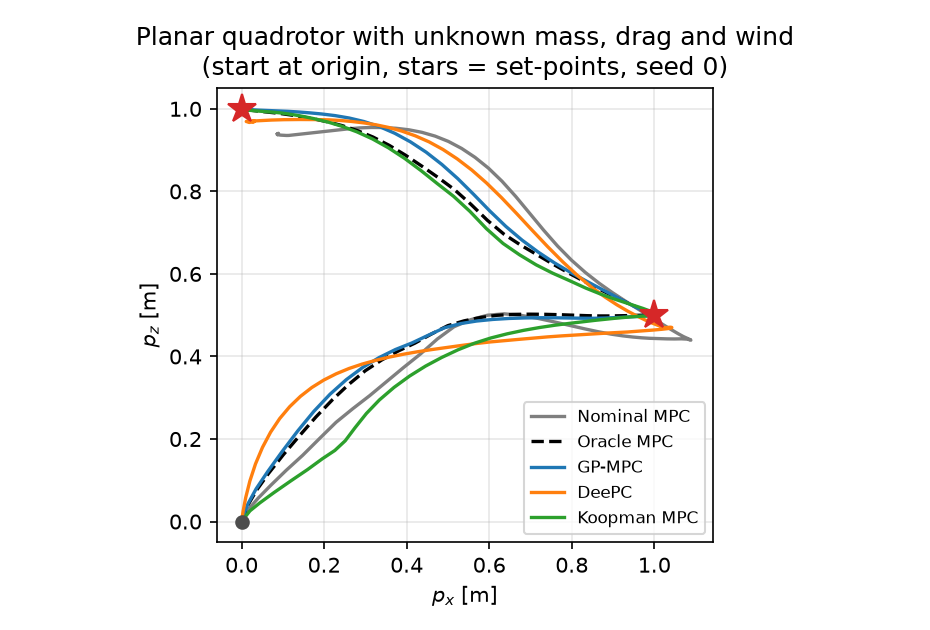
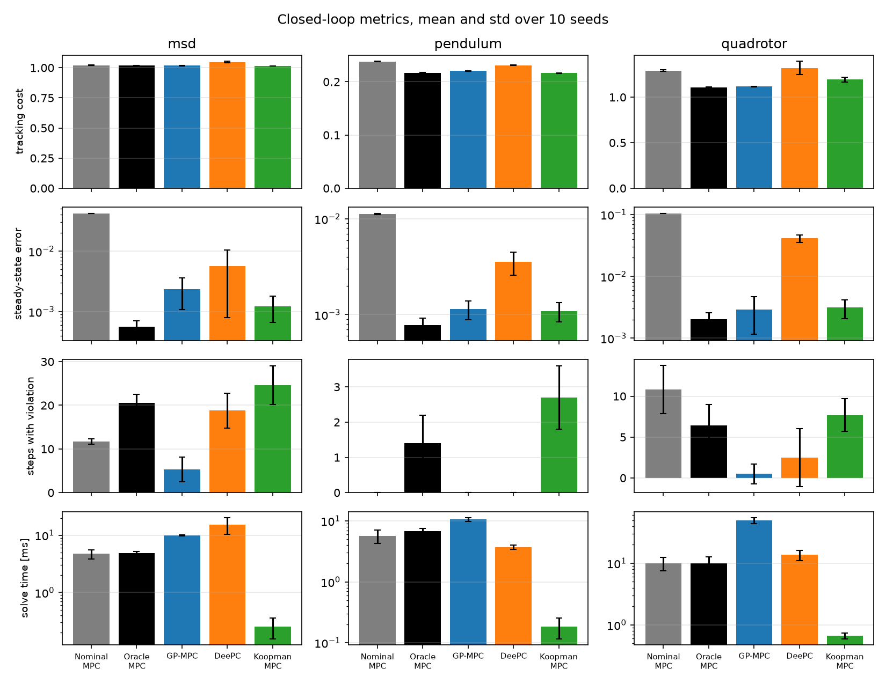
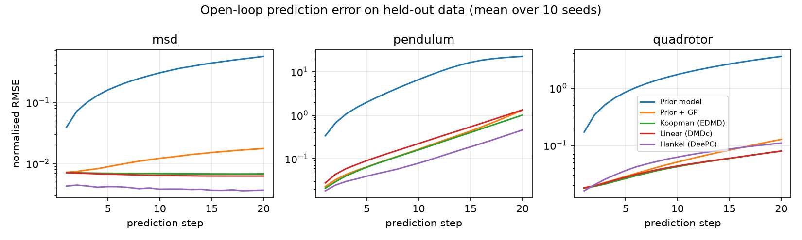

# Data-Driven-Control-Benchmark

**Learn a model of an uncertain plant from data, then control it: GP-MPC, DeePC and Koopman MPC compared on three simulated plants, under the same data, horizon, weights and constraints.**



## What this is

All three plants have a known structure and wrong parameters. The prior model is wrong, so MPC on that model leaves a steady-state offset. Each data-driven controller fixes the prior model in its own way:

| Controller | What it learns | Optimisation |
|---|---|---|
| **Nominal MPC** | nothing (prior model only) | NMPC, CasADi + IPOPT |
| **Oracle MPC** | nothing (true model, used as a reference) | NMPC, CasADi + IPOPT |
| **GP-MPC** | Gaussian-process residual on the accelerations, with variance-based constraint tightening | NMPC, CasADi + IPOPT |
| **DeePC** | nothing explicit: a Hankel matrix of measured data is the predictor (regularised) | QP, OSQP |
| **Koopman MPC** | linear model in a lifted space (EDMD with 40 radial basis functions) | QP, OSQP |

| Plant | State / input | Model mismatch (true vs prior) |
|---|---|---|
| Mass-spring-damper (LTI) | (p, v) / F | stiffness 2.0 vs 0.8, damping 0.4 vs 0.1, mass 1.0 vs 0.7 |
| Inverted pendulum | (θ, ω) / τ | mass 1.0 vs 0.6, viscous and Coulomb friction unknown |
| Planar quadrotor | (px, pz, φ, vx, vz, ω) / (T1, T2) | mass 1.0 vs 0.8, drag 0.4 and wind 0.6 N unknown |

Every learned component uses the same 1500 noisy samples per seed. The unstable plants are excited in closed loop: an LQR designed on the prior model tracks random set-points, with a dither added to its input. Each controller then runs a set-point tracking task with soft state constraints, evaluated on 10 seeds.

The mass-spring-damper is included because it is the one case where DeePC theory holds exactly. A unit test checks that, with noise-free data, the Hankel predictor reproduces the true trajectory (error below 1e-5).

## What is and is not guaranteed

- **DeePC:** the predictor is exact only for a noise-free LTI plant with persistently exciting data (the fundamental lemma). On noisy data and on the nonlinear plants the regularisation is a heuristic. No terminal ingredients are implemented, so there is no closed-loop stability guarantee. The weight λ_g was chosen on a separate tuning seed with a fixed rule ([e0](experiments/e0_tune_deepc.py), [figure](figures/deepc_sweep.png)).
- **GP-MPC:** the constraint margin is β = 2 GP standard deviations, summed along the previous plan. The sum ignores how uncertainty propagates through the dynamics, so the margin is a heuristic, not a certified bound. On held-out data the 2σ interval covered 94–96 % of one-step residuals. The GP is trained on a random subset of 150 of the 1500 samples.
- **Koopman MPC:** the lifted linear model is an approximation, and its prediction error against horizon is plotted below. There is no closed-loop guarantee.
- All data are simulated.

## Results



Closed loop, mean over 10 seeds. The steady-state error is the position error before the reference preview reaches the next set-point. "Max violation" is the largest constraint violation of a run, averaged over seeds. Solve times are from one laptop and are only comparable to each other.

**Mass-spring-damper** (DeePC λ_g = 100)

| Controller | Tracking cost | Steady-state error | Max violation | Steps violated | Solve time mean / max [ms] |
|---|---|---|---|---|---|
| Nominal MPC | 1.021 ± 0.001 | 0.0420 ± 0.0003 | 0.042 | 11.7 | 4.7 / 14 |
| Oracle MPC | 1.017 ± 0.001 | 0.0006 ± 0.0001 | 0.011 | 20.6 | 4.8 / 9 |
| GP-MPC | 1.018 ± 0.002 | 0.0024 ± 0.0013 | 0.006 | 5.3 | 9.9 / 20 |
| DeePC | 1.046 ± 0.006 | 0.0056 ± 0.0048 | 0.006 | 18.8 | 15.3 / 234 |
| Koopman MPC | 1.015 ± 0.002 | 0.0012 ± 0.0006 | 0.012 | 24.6 | 0.3 / 1 |

**Inverted pendulum** (DeePC λ_g = 100)

| Controller | Tracking cost | Steady-state error | Max violation | Steps violated | Solve time mean / max [ms] |
|---|---|---|---|---|---|
| Nominal MPC | 0.238 ± 0.001 | 0.0112 ± 0.0002 | 0.000 | 0.0 | 5.7 / 13 |
| Oracle MPC | 0.217 ± 0.000 | 0.0008 ± 0.0002 | 0.007 | 1.4 | 6.7 / 13 |
| GP-MPC | 0.220 ± 0.001 | 0.0011 ± 0.0003 | 0.000 | 0.0 | 10.5 / 21 |
| DeePC | 0.231 ± 0.001 | 0.0035 ± 0.0010 | 0.000 | 0.0 | 3.7 / 11 |
| Koopman MPC | 0.216 ± 0.001 | 0.0011 ± 0.0002 | 0.071 | 2.7 | 0.2 / 1 |

**Planar quadrotor** (DeePC λ_g = 1)

| Controller | Tracking cost | Steady-state error | Max violation | Steps violated | Solve time mean / max [ms] |
|---|---|---|---|---|---|
| Nominal MPC | 1.292 ± 0.010 | 0.1043 ± 0.0006 | 0.021 | 10.8 | 9.9 / 26 |
| Oracle MPC | 1.108 ± 0.003 | 0.0020 ± 0.0005 | 0.005 | 6.4 | 10.0 / 31 |
| GP-MPC | 1.117 ± 0.004 | 0.0029 ± 0.0017 | 0.001 | 0.5 | 49.5 / 145 |
| DeePC | 1.321 ± 0.073 | 0.0414 ± 0.0057 | 0.013 | 2.5 | 13.7 / 87 |
| Koopman MPC | 1.194 ± 0.028 | 0.0031 ± 0.0011 | 0.060 | 7.7 | 0.7 / 8 |

What the tables show:
- The prior model leaves an offset on every plant. GP-MPC and Koopman MPC reduce it to 0.001–0.003, close to the oracle. DeePC reduces it less on the quadrotor (0.041).
- GP-MPC has the fewest violation steps on every plant (on the pendulum it ties at zero with nominal MPC and DeePC). It is the only controller that tightens its constraints. On the quadrotor it is the slowest controller, at 49.5 ms mean against a 50 ms sampling time.
- Koopman MPC is the fastest controller (under 1 ms mean). It has the lowest cost on the mass-spring-damper and the pendulum, but the largest violations on the pendulum and the quadrotor (see the roll transient at t ≈ 0.3 s in the [quadrotor plot](figures/closed_loop_quadrotor.png)).
- DeePC has the highest cost and the largest spread on the quadrotor. On the mass-spring-damper its worst-case solve time (234 ms) exceeds the sampling time.
- The oracle has small violations on every plant, caused by measurement noise and the lack of a safety margin.
- Tracking cost is dominated by the transients after set-point changes, which every controller shares, so cost differences are small. The steady-state error and the violation numbers separate the methods more clearly.

### Prediction on held-out data



| Model | msd | pendulum | quadrotor |
|---|---|---|---|
| Prior model | 0.563 | 22.480 | 3.562 |
| Prior + GP | 0.018 | 1.306 | 0.127 |
| Koopman (EDMD) | 0.007 | 1.003 | 0.079 |
| Linear (DMDc, no basis functions) | 0.006 | 1.320 | 0.079 |
| Hankel (DeePC predictor) | 0.004 | 0.455 | 0.109 |
| GP 2σ coverage (one-step) | 0.959 | 0.951 | 0.940 |

The table gives the normalised RMSE after 20 open-loop steps. The pendulum is open-loop unstable, so every model drifts on it. The radial basis functions improve on plain DMDc only on the pendulum.

Closed-loop plots for seed 0: [mass-spring-damper](figures/closed_loop_msd.png), [pendulum](figures/closed_loop_pendulum.png), [quadrotor](figures/closed_loop_quadrotor.png).

A short report with the formulation, assumptions and results is in [docs/report.pdf](docs/report.pdf) (LaTeX source in `docs/`).

## How to run

Python 3.11. The conda route is easiest because CasADi ships IPOPT on conda-forge:

```bash
conda env create -f environment.yml
conda activate ddc
python -m pytest            # 16 tests
cd experiments
python run_all.py           # tuning, identification, closed loop, figures (10-15 min)
```

`pip install -r requirements.txt` also works where the CasADi wheel includes IPOPT.

Each step can also be run on its own: `e0_tune_deepc.py`, `e1_identification.py`, `e2_closed_loop.py [processes]` and `e3_figures.py` (figures and tables from the saved JSON files only).

Seeds: evaluation seeds 0–9 (data seed s, closed-loop noise seed 500 + s), tuning seed 100/600, held-out data seed 1000 + s.

## Folder structure

```
ddcbench/
  plants/        msd.py  pendulum.py  quadrotor2d.py  base.py (RK4, shared NumPy/CasADi dynamics)
  tasks.py       references, constraints, weights, noise per plant
  data.py        closed-loop data collection (LQR on the prior + dither)
  simulate.py    closed-loop simulation of the true plant
  metrics.py     cost, steady-state error, violations, solve time
  models/        gp.py (exact GP, CasADi mean)  residual.py  hankel.py  koopman.py
  controllers/   nmpc.py (nominal / oracle)  gp_mpc.py  deepc.py  koopman_mpc.py
experiments/     e0_tune_deepc.py  e1_identification.py  e2_closed_loop.py  e3_figures.py  run_all.py
results/         closed_loop.json  identification.json  deepc_tuning.json  tables.md
figures/         generated PNGs
docs/            report.tex  report.pdf  refs.bib
tests/           pytest
```

## References

- J. Coulson, J. Lygeros, F. Dörfler, *Data-Enabled Predictive Control: In the Shallows of the DeePC*, ECC 2019.
- J. Berberich, J. Köhler, M. A. Müller, F. Allgöwer, *Data-Driven Model Predictive Control With Stability and Robustness Guarantees*, IEEE TAC 66(4), 2021.
- L. Hewing, J. Kabzan, M. N. Zeilinger, *Cautious Model Predictive Control Using Gaussian Process Regression*, IEEE TCST 28(6), 2020.
- M. Korda, I. Mezić, *Linear predictors for nonlinear dynamical systems: Koopman operator meets model predictive control*, Automatica 93, 2018.

The full list is in [docs/refs.bib](docs/refs.bib).

## Author

Arshia Goshtasbi, MSc Electrical Engineering (Control), Iran University of Science and Technology. MIT licence.
